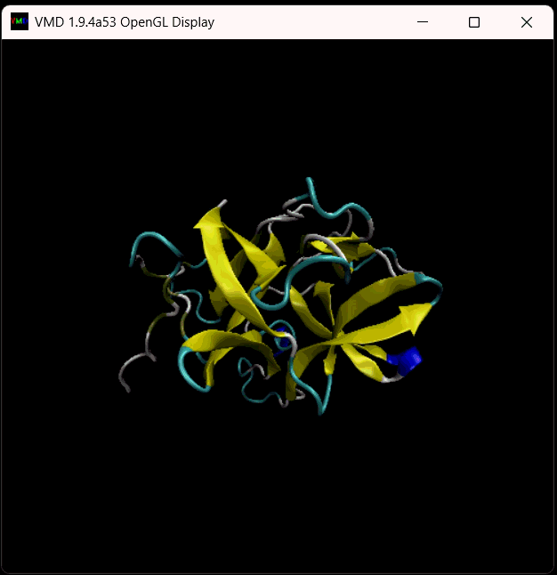
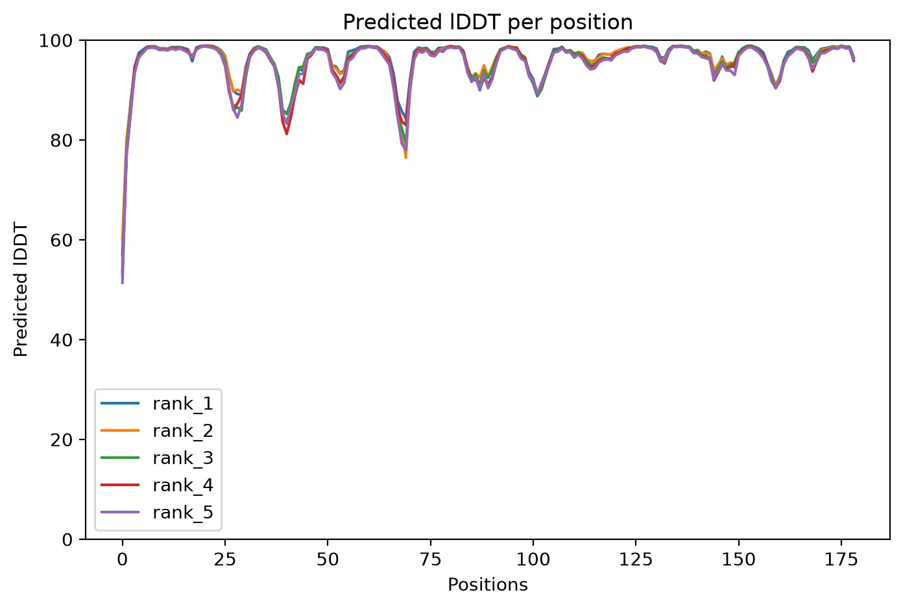
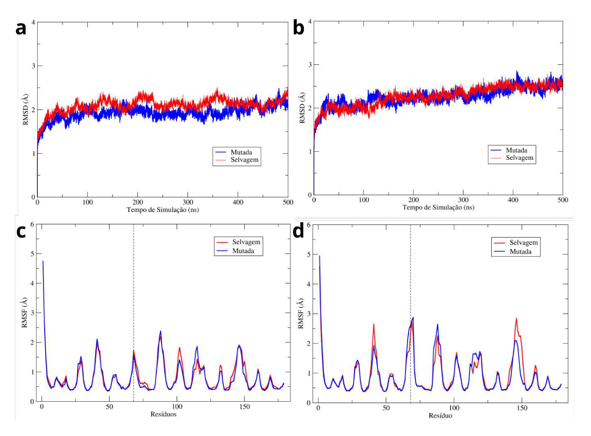
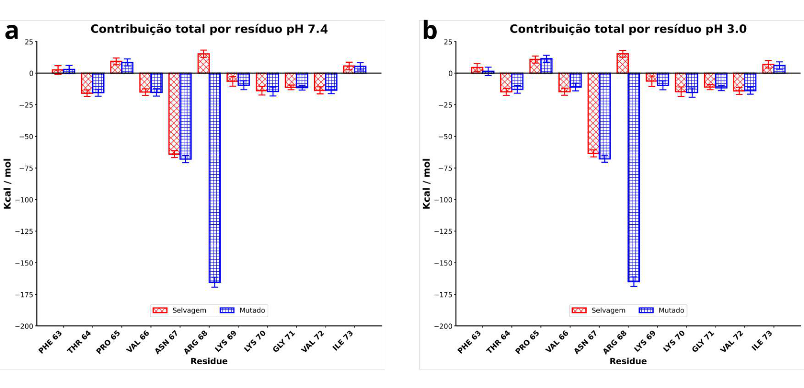
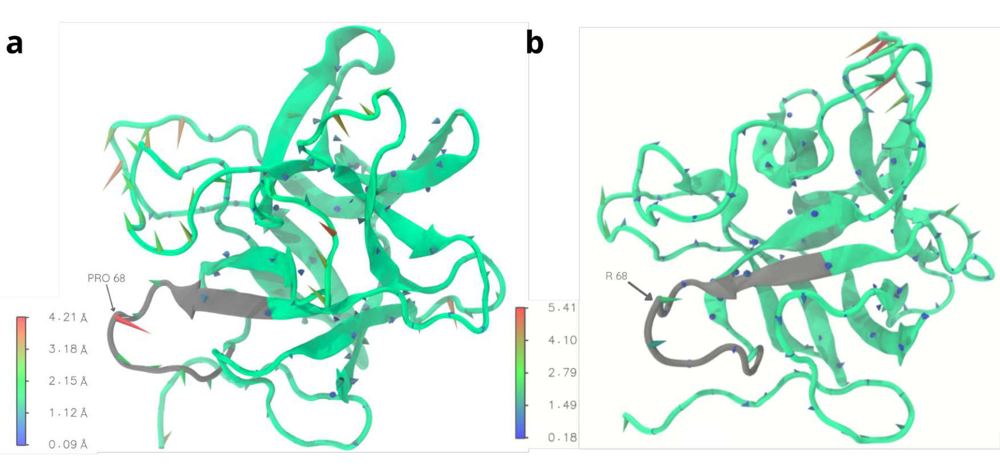

# vvMLP-P68R | Variante mutada da proteína semelhante à miraculina de *Vitis vinifera*

Repositório para disponibilização do **modelo estrutural predito da variante P68R** da *miraculin-like protein* de *Vitis vinifera* (**vvMLP**) e de resultados selecionados de sua caracterização computacional.

> **Escopo:** o PDB é um **modelo predito computacionalmente**, não uma estrutura cristalográfica experimental. As análises da proteína isolada **não comprovam** aumento da atividade inibitória contra a tripsina.

## Contexto e objetivo

A vvMLP (estrutura cristalográfica de referência: **PDB 5YH4**) pertence à família dos inibidores de proteases do tipo Kunitz e apresenta atividade inibitória contra a tripsina. Estudos anteriores de dinâmica molecular e decomposição energética destacaram a **Pro68**, no laço reativo, por apresentar contribuição energética positiva próxima de **+15 kcal/mol**.

A comparação estrutural com o *soybean trypsin inhibitor* (STI) mostrou que essa posição corresponde à **Arg63/P1** do STI. Considerando a importância do resíduo P1 no reconhecimento da tripsina, foi proposta a substituição **Pro68 → Arg (P68R)**, com o objetivo de avaliar seus efeitos estruturais, de flexibilidade e energéticos.

## Mutação P68R

- **Proteína:** vvMLP (*Vitis vinifera*)
- **Referência experimental para comparação:** PDB `5YH4`
- **Sequência madura utilizada:** 179 aminoácidos
- **Mutação:** `P68R` (prolina → arginina na posição 68)
- **Segmento original (posições 65–73):** `PVNPKKGVI`
- **Segmento mutado (posições 65–73):** `PVNRKKGVI`
- **Predição estrutural:** ColabFold/AlphaFold2-ptm; modelo de melhor ranqueamento

## Arquivo estrutural

| Arquivo | Descrição |
|---|---|
| [`P68R.pdb`](vvMLP_P68R.pdb) | Estrutura predita da variante P68R (**adicione o arquivo a este repositório**) |

O PDB pode ser visualizado, por exemplo, no **VMD**:

## Visualização da estrutura no VMD

O modelo tridimensional da variante P68R da vvMLP pode ser visualizado utilizando o **VMD (Visual Molecular Dynamics)**, ferramenta para visualização e análise de estruturas moleculares.

Para carregar a estrutura:

1. Abra o VMD.
2. Acesse **File → New Molecule → Browse**.
3. Selecione o arquivo `P68R.pdb` e clique em **Load**.
4. Acesse **Graphics → Representations**.
5. Em **Drawing Method**, selecione `NewCartoon`.
6. Em **Coloring Method**, selecione `Structure` para diferenciar as estruturas secundárias da proteína.

> **Atenção:** a seleção `resid 68` depende da numeração dos resíduos no arquivo PDB. Caso a numeração seja diferente, ajuste a seleção conforme a estrutura utilizada.

### Visualização tridimensional da vvMLP-P68R


<p align="center">
  
</p>

<p align="center">
  <em>Representação tridimensional da variante P68R da vvMLP no VMD.</em>
</p>


## Metodologia resumida

1. Seleção da posição 68 a partir de análises estruturais e de decomposição energética por resíduo da vvMLP selvagem.
2. Substituição **Pro68→Arg** na sequência madura e predição do modelo com **ColabFold/AlphaFold2-ptm**.
3. Comparação do modelo P68R com a estrutura cristalográfica selvagem **5YH4**, incluindo RMSD global e do laço 65–73.
4. Simulações de dinâmica molecular em **pH 7,4 e 3,0**, com **AMBER 24**, campo de força **ff19SB** e água **OPC**.
5. Análises de **RMSD**, **RMSF**, movimentos estruturais (*Porcupine plot*) e decomposição energética **MM/GBSA** (MMPBSA.py, `igb=5`, 25.000 frames).

## Resultados principais

| Medida | Resultado |
|---|---:|
| pLDDT médio do modelo P68R | **96,08** |
| pLDDT da Arg68 | **87,81** |
| RMSD global na sobreposição com 5YH4 | **≈ 0,49 Å** |
| RMSD do laço 65–73 (Cα) | **0,618 Å** |
| RMSF médio global da P68R | **0,77 Å** |
| RMSF médio do laço 63–73 | **0,76 Å** |
| RMSF da Arg68 | **1,57 Å** |
| Contribuição energética da Pro68 na vvMLP selvagem | **≈ +15 kcal/mol** |
| Contribuição energética da Arg68 na P68R (pH 7,4) | **−165,42 kcal/mol** |
| Componente eletrostático da Arg68 (pH 7,4) | **−139,85 kcal/mol** |

O modelo predito conservou o dobramento global e a geometria inicial do laço reativo na comparação estrutural. As simulações mostraram perfis globais semelhantes de RMSD/RMSF entre vvMLP selvagem e P68R, com mobilidade localizada na posição 68. A decomposição energética indicou mudança marcante da contribuição na posição 68, com **o mesmo contraste qualitativo em pH 7,4 e 3,0**.

### Confiança da predição (pLDDT)

<p align="center">
  
</p>

*Valores de pLDDT para os cinco modelos preditos pelo ColabFold/AlphaFold2-ptm.*

### RMSD e RMSF: vvMLP selvagem × P68R



*(a) RMSD em pH 7,4; (b) RMSD em pH 3,0; (c) RMSF em pH 7,4; (d) RMSF em pH 3,0.*

### Contribuição energética por resíduo



*Comparação entre vvMLP selvagem e P68R nos resíduos 63–73: (a) pH 7,4; (b) pH 3,0. Valores negativos são contribuições favoráveis no modelo de decomposição empregado; não equivalem, isoladamente, a uma medida de estabilidade conformacional.*

### Movimentos estruturais (*Porcupine plot*)



*Representações dos movimentos estruturais da (a) vvMLP selvagem, com Pro68, e (b) variante P68R, com Arg68. As escalas dos painéis diferem; a figura não permite, isoladamente, quantificar a diferença de mobilidade.*

## Limitações e próximos passos

Os resultados **caracterizam a proteína isolada**, não sua interação direta com a tripsina. Portanto, a contribuição energética mais negativa de Arg68 **não é evidência suficiente de maior potência inibitória**. A etapa futura indicada no estudo é a avaliação comparativa dos complexos **tripsina–vvMLP selvagem** e **tripsina–P68R**.

## Estrutura do repositório

```text
vvMLP-P68R/
├── README.md
├── P68R.pdb               
└── figures/
    ├── plddt_p68r.png
    ├── rmsd_rmsf_wt_p68r.png
    ├── energia_wt_p68r.png
    └── movimentos_wt_p68r.png
```

## Referências citadas nos materiais da pesquisa

- KHAMRUI, S. et al. *Single mutation at P1 of a chymotrypsin inhibitor changes it to a trypsin inhibitor: X-ray structural (2.15 Å) and biochemical basis*. 2005.
- KROWARSCH, D. et al. *Canonical protein inhibitors of serine proteases*. Cellular and Molecular Life Sciences, 2003.
- MIRDITA, M. et al. *ColabFold: making protein folding accessible to all*. Nature Methods, 2022.
- OHKURA, S. et al. *Structural and functional analysis of miraculin-like protein from Vitis vinifera*. Biochimica et Biophysica Acta – Proteins and Proteomics, v. 1866, p. 1125–1130, 2018.

## Origem dos dados

Os dados, modelos estruturais e figuras disponibilizados neste repositório são provenientes da pesquisa desenvolvida no âmbito do Programa Institucional de Bolsas de Iniciação em Desenvolvimento Tecnológico e Inovação (PIBITI), realizada no Instituto Federal de Brasília (IFB), Campus Planaltina.

Os resultados apresentados foram obtidos por meio de modelagem molecular, predição estrutural e simulações de dinâmica molecular, sendo também utilizados na elaboração do relatório técnico final e em trabalhos apresentados em eventos científicos.

**Direitos de uso:** os dados e materiais disponibilizados são de autoria da equipe de pesquisa. A ausência de uma licença explícita não implica autorização para reprodução, modificação ou redistribuição. Para essas finalidades, recomenda-se entrar em contato com os autores responsáveis..
